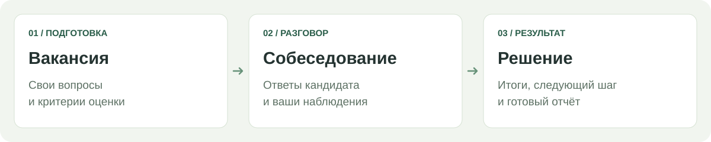

<strong>Подготовьте разговор. Запишите ответы. Сохраните решение.</strong>

<a href="#запуск">Быстрый запуск</a> · <a href="docs/guide.md">Руководство</a> · <a href="https://github.com/schiz027/InterviewFlow/issues">Сообщить об ошибке</a>

InterviewFlow помогает проводить собеседования и сохранять результаты: вакансии, кандидаты, вопросы и наблюдения — в одном окне браузера. Работает на вашем компьютере или в доверенной локальной сети. Решение о найме остаётся за человеком.

| Для разговора | Для результата |
| --- | --- |
| Вакансии со своими вопросами и критериями | Оценки с обоснованием и итоговые заметки |
| Карточки кандидатов, поиск и статусы | Полный или краткий отчёт: DOCX, TXT, печать / PDF |
| Подсказки, пропуск вопросов, светлая и тёмная темы | Автосохранение, резервные копии и контроль конфликтов |

## Запуск

Нужны **Python 3.10+** и современный браузер. Дополнительные библиотеки не требуются.

1. [Скачайте ZIP со страницы релизов](https://github.com/schiz027/InterviewFlow/releases) и распакуйте.
2. Откройте **`Запустить.cmd`** в Windows или выполните `python server.py`.
3. Откройте адрес из окна запуска и введите показанный **PIN-код**.

Для совместной работы запустите сервер на одном компьютере, а на остальных откройте его сетевой адрес.

> **Ваши данные — у вас.** Анкеты и шаблоны сохраняются в папке `data`. HTTP не шифруется: используйте только доверенную локальную сеть и не открывайте сервер в интернет. Общий PIN даёт доступ ко всем анкетам.

<a href="docs/guide.md">Хранение данных и резервные копии</a> · <a href="SECURITY.md">Безопасность</a> · <a href="CONTRIBUTING.md">Участие в проекте</a> · <a href="LICENSE">MIT License</a>

